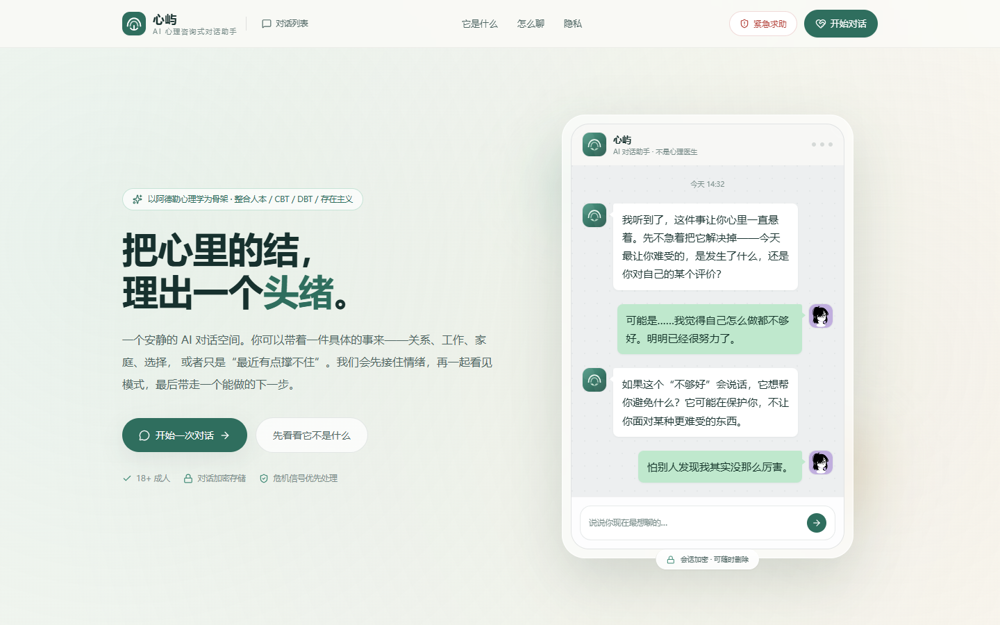
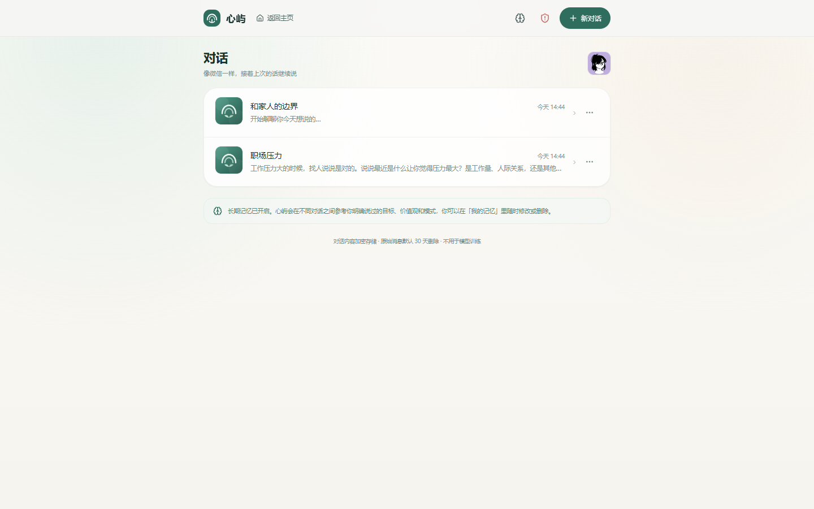
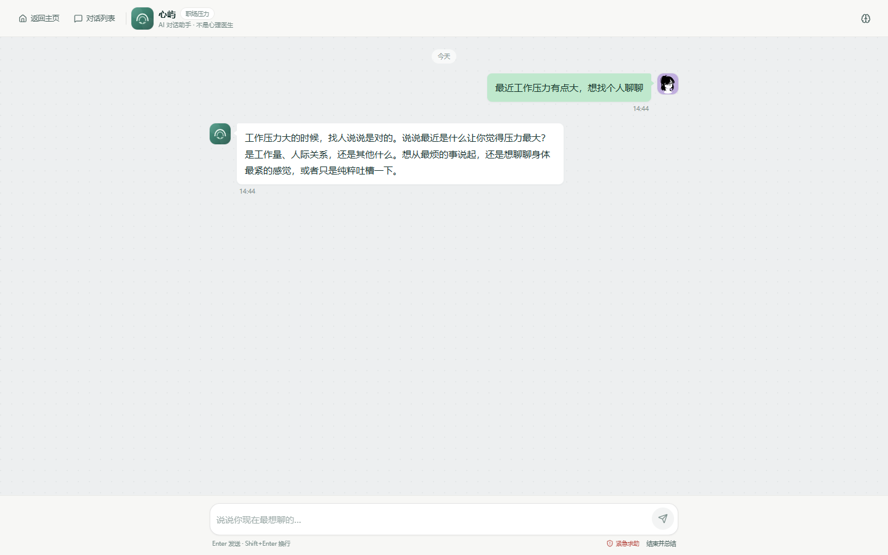
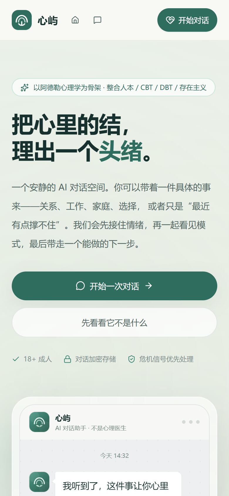

# 心屿 · 心理咨询 Agent

> 一个把心理学对话做得更真实、更有出路的 AI 心理自助工具。

心屿以 **阿德勒心理学** 为骨架，整合人本主义、CBT、DBT、REBT 与存在主义视角。它不是要给你一个标准答案，而是陪你：

**说清楚 → 看见模式 → 换个角度 → 带走一个能做的下一步。**

> **重要边界**：心屿是 AI 心理咨询式对话助手，不是心理医生，不做诊断、治疗、开药，不能替代持证心理咨询师或精神科医师。当前为内部原型，正式上线前必须经过持证专业人士审阅。



---

## 目录

- [项目简介](#项目简介)
- [适合谁，不适合谁](#适合谁不适合谁)
- [界面预览](#界面预览)
- [核心能力](#核心能力)
- [使用说明](#使用说明)
- [快速开始](#快速开始)
- [环境变量](#环境变量)
- [项目结构](#项目结构)
- [技术架构](#技术架构)
- [长期记忆](#长期记忆)
- [测试与验证](#测试与验证)
- [安全与合规](#安全与合规)
- [已知边界](#已知边界)
- [文档与素材](#文档与素材)

---

## 项目简介

很多“心理 AI”会停在两种状态：一种是不断说“我理解你”，另一种是不断追问，把用户问累。

心屿想做的是第三种：

- **先接住**：用用户自己的话，确认他正在经历什么；
- **再看见**：帮用户找到重复的模式、背后的目的、拉扯的关系；
- **给视角**：用阿德勒式提问或一个轻量的心理工具，换一个看法；
- **落到下一步**：把“想改变”变成一个低门槛、可执行的小动作；
- **知道边界**：该转介时转介，该停下时停下。

它不是“陪聊机器人”，也不是“心理百科”。它的目标是一次有结构、有温度、有出路的对话。

---

## 适合谁，不适合谁

| 适合 | 不适合 |
|---|---|
| 18 岁以上成年人 | 未成年人 |
| 正在经历轻到中度的情绪困扰、关系困扰、职场压力、人生选择、自我怀疑 | 严重精神障碍急性期、主动自杀计划、精神病性症状 |
| 愿意通过对话自我探索 | 需要医疗诊断、处方、药物治疗的人 |
| 想整理思路、获得一个新视角的人 | 只想被无条件哄着、或寻找恋爱/性角色扮演的人 |

如果你或身边的人正处于紧急危险中，请优先拨打 **110 / 120**，或联系当地精神卫生中心、医院精神科/心理科。

---

## 界面预览

### 首页


### 对话列表

对话支持自定义名称、重命名和删除；长期记忆默认关闭，需要单独开启。



### 聊天页

微信式气泡、流式回复；AI 会在回复里承接前文，而不是只回答最后一句话。



### 手机端



> 截图中的对话、头像与名称为演示数据，不是真实用户信息。

---

## 核心能力

### 1. 心理咨询式对话

- 阿德勒心理学为骨架：目的论、课题分离、横向关系、社会兴趣、鼓励、私人逻辑；
- 需要时借用 CBT / DBT / REBT 的具体工具；
- 不堆术语，一次最多用 1–2 个技术；
- 像微信聊天，不像文章或客服话术；
- 一次最多一个问题，不连续追问；用户要建议时直接给具体做法。

### 2. 安全优先

每条用户消息都会经过独立的规则安全层：

- 识别自伤、自杀、伤人、家暴、性侵、严重精神症状、未成年人、医疗请求等信号；
- L2/L3 直接进入危机流程，不交给主模型自由发挥；
- 提供 110 / 120 / 12356 等资源；
- 未成年人直接阻断咨询式对话，引导监护人或学校心理老师；
- 医疗请求只做转介与“要问医生的问题清单”，不给诊断或药物建议。

### 3. 长期记忆

- 默认关闭，首次同意页单独开启；
- 只记录稳定的目标、价值观、偏好、重要关系、反复模式；
- 临时情绪、敏感身份信息、危机细节不自动写入；
- 同义记忆合并，冲突记忆更新或归档；
- 可在 `/memory` 查看、编辑、删除、暂停、清空；
- 记忆内容使用 AES-256-GCM 加密存储。

详见 [docs/memory.md](docs/memory.md)。

### 4. 总结与反馈

会话结束后生成一页总结：

- 你带来的困扰；
- 看见的模式；
- 你的资源与优势；
- 你想去的方向；
- 本周可以试的一小步；
- 这次记住的内容（如果开启了长期记忆）。

总结页还支持“有帮助 / 安全边界”评分与文字反馈。

### 5. 隐私与可控

- 匿名签名 Cookie，不收集邮箱、手机号；
- 对话和记忆内容加密存储；
- 默认不使用用户对话做模型训练；
- 可删除单条对话、批量清理记忆、清空全部记忆；
- 隐私政策、用户协议、危机资源页齐全。

---

## 使用说明

### 首次使用

1. 打开 `http://localhost:3000`；
2. 阅读并确认 18+、AI 身份、隐私边界；
3. 勾选知情同意；
4. 选择是否开启长期记忆；
5. 选择一个头像；
6. 进入对话列表。

完成一次后，下次点击「开始对话」会直接进入对话列表，不会重复三步确认；如果隐私政策/用户协议版本更新，会只针对变更部分重新征得同意。

### 开始一段对话

1. 在对话列表点击「新对话」；
2. 在输入框里说一件具体的事，比如“最近工作压力有点大”；
3. 心屿会先接住，再根据你的状态选择探索、解释或给建议；
4. 想继续时直接回复；想结束时点「结束并总结」。

### 管理对话

- 每条对话右侧的「···」菜单可以**重命名**；
- 同一菜单可以**删除对话**，删除后会同时清理由该对话产生的记忆；
- 页面左上角常驻「返回主页 / 对话列表」入口，当前页面不会再重复显示对应入口。

### 管理长期记忆

- 进入「我的记忆」查看所有已保存内容；
- 可以逐条编辑、删除；
- 可以暂停记忆开关，之后新对话不再参考旧记忆；
- 也可以清空全部记忆。

---

## 快速开始

### 环境要求

- Node.js ≥ 20
- pnpm（项目使用 `corepack pnpm`）
- Windows / macOS / Linux 均可

### 安装

```bash
# 1. 安装依赖
corepack pnpm install

# 2. 复制环境变量模板
cp .env.example .env
# Windows PowerShell:
# Copy-Item .env.example .env

# 3. 生成加密密钥和会话密钥
node -e "console.log('ENCRYPTION_KEY=' + require('crypto').randomBytes(32).toString('base64'))"
node -e "console.log('AUTH_SECRET=' + require('crypto').randomBytes(32).toString('hex'))"
# 把输出分别填到 .env 的 ENCRYPTION_KEY / AUTH_SECRET

# 4. 初始化数据库
corepack pnpm db:setup

# 5. 启动开发服务器
corepack pnpm dev
```

打开 <http://localhost:3000>。

### Windows 一键启动

直接双击项目根目录的 `启动心屿.bat`：

- 自动检查依赖、数据库和构建产物；
- 服务就绪后自动打开浏览器；
- 关闭弹出的终端窗口即可停止服务。

> 脚本默认使用生产模式 `next start`；如果你正在改代码，请用 `corepack pnpm dev`。

### 接入真实大模型

默认 `LLM_MOCK=true`，不需要 API Key 就能跑完整 UI、记忆和安全流程。

接入智谱 GLM-4.5-Flash 的示例：

```bash
LLM_MOCK=false
LLM_PROVIDER=zhipu
LLM_API_KEY=你的智谱 API Key
LLM_MODEL=glm-4.5-flash
LLM_BASE_URL=https://open.bigmodel.cn/api/paas/v4
LLM_THINKING=disabled
```

任何 OpenAI-compatible 服务都可以通过 `LLM_BASE_URL` / `LLM_MODEL` 切换。API Key 只在服务端使用，不会进入客户端 bundle。

> 智谱免费额度模型：`glm-4-flash`、`glm-4.5-flash` 可直接使用；`glm-4.7` / `glm-5.x` 等模型需要账户有对应资源包。接口提示“余额不足或无可用资源包”时，请先到智谱控制台领取资源包。

---

## 环境变量

| 变量 | 必填 | 说明 |
|---|---|---|
| `DATABASE_URL` | 是 | SQLite 默认 `file:./dev.db`，可换 PostgreSQL |
| `ENCRYPTION_KEY` | 是 | 32 字节 base64，用于 AES-256-GCM |
| `AUTH_SECRET` | 是 | 匿名 Cookie 签名密钥 |
| `LLM_MOCK` | 是 | `true` 使用 Mock，`false` 调用真实模型 |
| `LLM_PROVIDER` | 真实模型时 | 例如 `zhipu` |
| `LLM_API_KEY` | 真实模型时 | 服务端密钥，不要提交到仓库 |
| `LLM_MODEL` | 真实模型时 | 例如 `glm-4.5-flash` |
| `LLM_BASE_URL` | 真实模型时 | OpenAI-compatible 接口地址 |
| `LLM_THINKING` | 否 | 智谱可设 `disabled`，降低首字延迟 |
| `NEXT_PUBLIC_APP_URL` | 否 | 应用公开地址 |

> `.env` 已在 `.gitignore` 中排除；提交前请确认没有把真实 Key 写入文档或示例代码。

---

## 项目结构

```text
app/
  page.tsx                 落地页
  start/                   18+ 确认、知情同意、头像选择
  chat/                    对话列表
  chat/[sessionId]/        聊天页
  summary/[id]/            会话总结
  memory/                  长期记忆管理
  about/ privacy/ terms/ crisis/
  api/                     consent / chat / summary / memory / session / health / feedback
components/
  chat/                    气泡、输入框、会话菜单
  consent/                 三步开始流程
  layout/                  品牌、顶部导航、页脚
  memory/                  记忆管理 UI
  summary/                 总结与反馈
  avatars/                 12 个用户头像 + AI 品牌头像
lib/
  ai/                      provider、mock、prompts、agents
  safety/                  规则引擎、危机资源
  memory/                  写入策略、去重、检索评分
  crypto/ auth/ db/ validation/
prisma/
  schema.prisma            User / Session / Message / Summary / Memory / Risk / Feedback
tests/
  unit/ safety/ e2e/
docs/
  memory.md                长期记忆设计
  methodology.md            方法论
  safety.md                 安全与合规
  credits.md                头像与素材来源
```

---

## 技术架构

| 层 | 选择 |
|---|---|
| 前端 | Next.js 15 App Router + React 19 + TypeScript strict + Tailwind CSS |
| 后端 | Next.js Route Handlers + SSE 流式输出 |
| 数据 | Prisma 6 + SQLite（schema 可迁移到 PostgreSQL） |
| 模型 | OpenAI-compatible；当前示例为智谱 GLM-4.5-Flash；无 Key 可切 Mock |
| 加密 | Node `crypto` AES-256-GCM，消息与记忆内容加密 |
| 认证 | 匿名 HMAC 签名 Cookie |
| 测试 | Vitest + Playwright |
| 部署 | 本地 / Docker / 云主机；正式面向公众需按适用法规完成备案与安全评估 |

### 对话调用链

```text
用户消息
  ↓
SafetyAgent（规则识别，L2/L3 直接危机流程）
  ↓
CounselorAgent（阿德勒式对话 + 记忆上下文 + 最近对话前文）
  ↓
流式返回 / 保存消息
  ↓
SummaryAgent（结束并总结时）
  ↓
MemoryAgent（用户开启记忆时，按策略提取 / 合并）
```

---

## 长期记忆

实现遵循“少而有用”的原则：

1. **什么时候写**：会话总结、每 6 个用户回合检查一次、用户明确说“记住”时立即整理；
2. **写什么**：稳定目标、价值观、偏好、重要关系、反复模式；一次性情绪和敏感信息不写；
3. **怎么合并**：同义记忆去重，冲突记忆更新或归档，不重复堆叠；
4. **怎么读**：按重要性 × 新近度 × 相关度取 Top 8–10 条注入上下文；
5. **怎么控制**：用户可在 `/memory` 查看、编辑、删除、暂停、清空。

完整策略见 [docs/memory.md](docs/memory.md)。

---

## 测试与验证

```bash
corepack pnpm typecheck   # TypeScript strict
corepack pnpm test       # 单元测试 + 安全回归（当前 61 个测试）
corepack pnpm test:e2e   # Playwright 完整流程
corepack pnpm build      # 生产构建
corepack pnpm lint       # ESLint
```

当前测试覆盖：

- 54 个安全规则用例（自伤、自杀、家暴、性侵、未成年人、医疗请求、prompt injection 等）；
- 单元测试：加密、记忆评分；
- E2E：同意 → 选头像 → 对话 → 总结 → 记忆的完整流程。

---

## 安全与合规

- **不是心理医生**：不做诊断、治疗、开药、疗效承诺；
- **不是 AI 恋人**：不做恋爱/性角色扮演，不诱导依赖；
- **18+**：未成年人识别后阻断咨询式对话；
- **危机优先**：L2/L3 先走安全流程，不交给主模型自由发挥；
- **隐私优先**：最小化收集、加密存储、可删除、不用于训练；
- **AI 身份透明**：不假装真人、不假装有执业资质。

紧急资源：**110**（报警）/ **120**（急救）/ **12356**（全国心理援助热线）/ **010-82951332**（北京心理危机研究与干预中心）/ **400-161-9995**（希望24热线）。

> 正式上线前必须由持证心理咨询师/精神科医师审阅内容与危机流程，并完成适用的备案、算法登记与安全评估。

---

## 已知边界

- 当前为内部原型，没有真实临床顾问审阅，不能对外正式运营；
- 原始消息 30 天自动清理尚未做定时任务；
- 没有邮箱登录/多设备同步，清除 Cookie 会失去会话；
- 没有语音、3D、虚拟人、恋爱/性角色扮演；
- 真实 LLM 接入需自行申请 Key，并遵守服务商条款与中国内地适用法规；
- 仓库暂未添加 LICENSE，默认保留所有权利；如需复用请先联系作者。

---

## 文档与素材

- [长期记忆设计](docs/memory.md)
- [方法论说明](docs/methodology.md)
- [安全与合规](docs/safety.md)
- [头像与素材来源](docs/credits.md)
- [提示词改造任务书](docs/提示词改造任务书.md)

### 头像

- 用户头像：DiceBear **Lorelei** 风格，作者 Lisa Wischofsky，**CC0 1.0**，已本地化到 `public/avatars/`；
- AI 头像：项目自绘 SVG，不使用真人照片或明星肖像。

---

## 仓库

GitHub：<https://github.com/Jerry-Tang95/counseling-agent>

如果这个项目对你有帮助，欢迎 Star；如果你发现安全问题，请优先通过仓库 Issue 或私下联系维护者，不要在公开 Issue 里贴真实对话或密钥。
